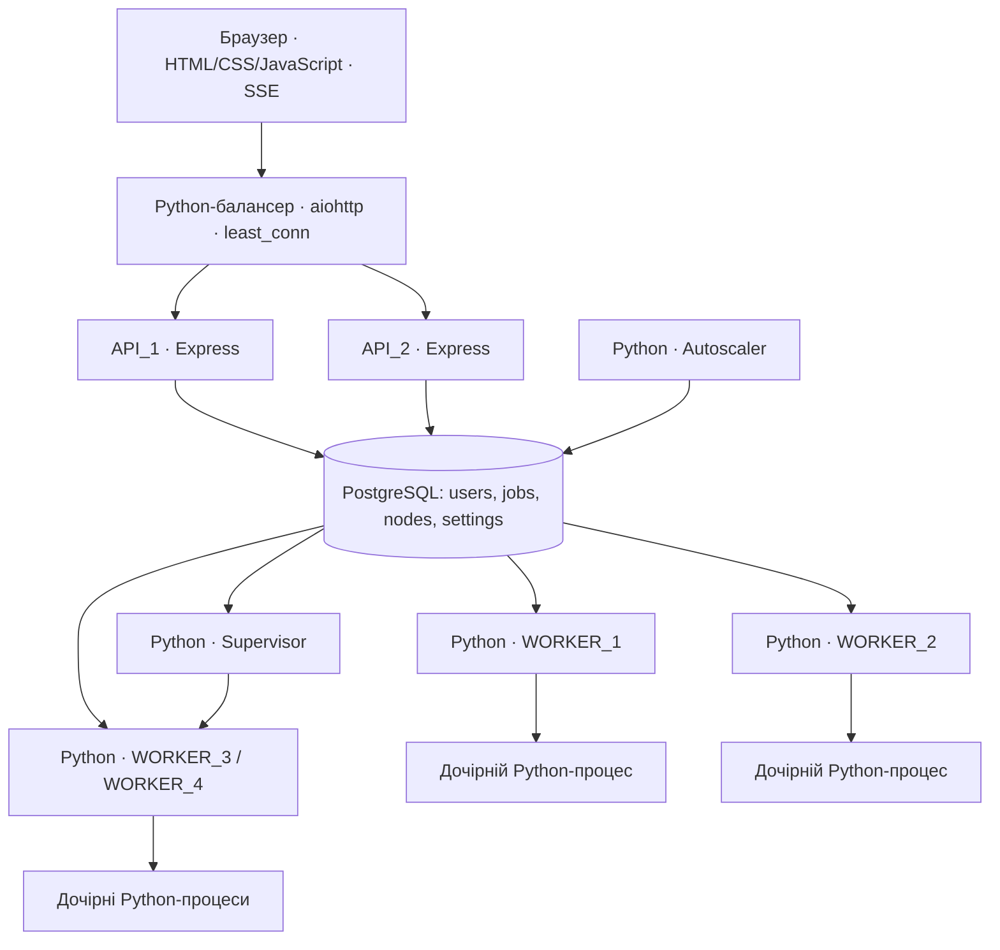

# Архітектура Tempo

Відкрийте http://localhost:8088/architecture.html для схеми, пояснень та друку. Векторний рисунок: `frontend/assets/architecture.svg`.

Фронтенд написаний на HTML/CSS/JavaScript; HTTP API залишається на JavaScript та Express. Балансер, воркери з оптимізатором і керування воркерами написані на Python. Дані й черга зберігаються тільки у PostgreSQL. API підключається через `pg`, Python-компоненти — через `psycopg`. Redis, RabbitMQ та інші брокери повідомлень не використовуються.

## Життєвий цикл

1. API перевіряє JWT, власника, ліміти, граф залежностей і допустимі ресурси.
2. Транзакція блокує рядок користувача, перевіряє число активних задач і додає рядок `jobs` зі статусом `queued`.
3. Воркер одним SQL `UPDATE … FROM (SELECT … FOR UPDATE SKIP LOCKED)` переводить одну задачу в `running`.
4. В окремому Python-процесі обчислюються початковий розклад і пошук simulated annealing. Прогрес надходить основному воркеру через `multiprocessing.Pipe`.
5. Воркер перевіряє стан і записує отриманий прогрес приблизно кожні 350 мс. API передає зміни через SSE, опитуючи БД кожні 750 мс.
6. Завершення: `completed`, `failed` або `cancelled`. Результат та історія залишаються в БД.

## Балансування та масштабування

Python-балансер на `aiohttp` обирає API з найменшим числом активних запитів, включаючи відкриті SSE-з’єднання. За рівних значень чергує сервери. Вибір і збільшення лічильника виконуються під `asyncio.Lock`; після відповіді або розриву з’єднання лічильник зменшується. `/balancer/status` показує ці лічильники. Якщо з’єднання з API не встановилося, балансер тимчасово виключає його та пробує інший. Після можливої доставки запиту автоматичного повторення немає.

Обидва API мають однаковий код і спільний JWT_SECRET. Сесія не прив’язана до конкретного API. `X-Served-By` і `X-Handled-By` ідентифікують API та upstream; `X-Balancer: Python-least_conn` підтверджує балансер. Тіло SSE передається потоково без очікування завершення відповіді. Локальний балансер слухає HTTP 8088 і, за наявності сертифіката, HTTPS 8443.

Autoscaler раз на 2 секунди оцінює активні й очікуючі розрахунки та встановлює `settings.desired_workers` у межах 2–4. Після 20 секунд низького попиту повертає ціль до 2.

У локальному запуску Supervisor створює й завершує окремі процеси резервних воркерів. Базові два воркери залишаються запущеними. Перед зупинкою резервний воркер має перестати брати нові задачі та завершити поточну.

У Docker-режимі всі чотири контейнери вже запущені, а автомасштабування вмикає та вимикає їхні слоти обробки. Нові контейнери автоматично не створюються.

## Алгоритм і практичні межі

Цільова оцінка: `makespan + 2 × total tardiness`. Залежності мають утворювати DAG. Один ресурс виконує одну задачу за раз; задачу не можна перервати й продовжити на іншому ресурсі. Відпустки, зміни, календарні дати та різна продуктивність виконавців не моделюються. Час виражається в умовних годинах від початку плану.

Simulated annealing змінює пріоритети задач та призначення ресурсів. List scheduling зберігає допустимість розкладу. Seed робить пошук відтворюваним за однакового вводу. Глобальний оптимум не гарантується. Найкращий варіант зберігається окремо й не гірший за baseline.

Дочірній процес обчислення примусово завершується після тайм-ауту. Скасування термінально змінює рядок у БД, тому пізніший результат його не перезапише. Після 25 секунд без heartbeat задачу можна повторити; номер спроби захищає від пізнього запису попереднього воркера.

## Джерела

- [PostgreSQL: SELECT, SKIP LOCKED](https://www.postgresql.org/docs/current/sql-select.html)
- [Python: multiprocessing](https://docs.python.org/3/library/multiprocessing.html)
- [aiohttp: HTTP-сервер](https://docs.aiohttp.org/en/stable/web_reference.html)
- [aiohttp: HTTP-клієнт](https://docs.aiohttp.org/en/stable/client_reference.html)
- [Psycopg: підключення до PostgreSQL](https://www.psycopg.org/psycopg3/docs/basic/usage.html)
