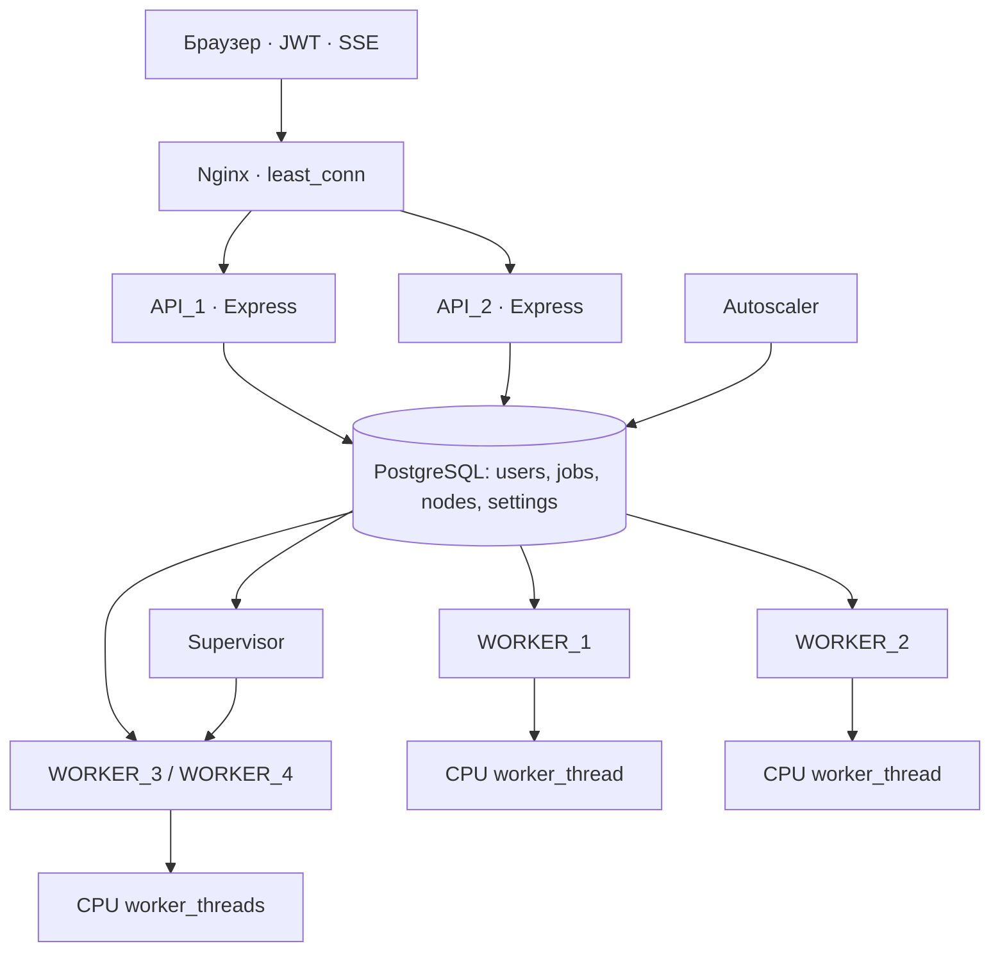

# Архітектура Tempo

Відкрийте http://localhost:8088/architecture.html для схеми, пояснень та друку. Векторний рисунок: `frontend/assets/architecture.svg`.

Дані й черга зберігаються тільки у PostgreSQL. Бібліотека `pg` підключає процеси до однієї БД. Redis, RabbitMQ та інші брокери повідомлень не використовуються.

## Життєвий цикл

1. API перевіряє JWT, власника, ліміти, граф залежностей і допустимі ресурси.
2. Транзакція блокує рядок користувача, перевіряє число активних задач і додає рядок `jobs` зі статусом `queued`.
3. Воркер одним SQL `UPDATE … FROM (SELECT … FOR UPDATE SKIP LOCKED)` переводить одну задачу в `running`.
4. В окремому `worker_thread` обчислюються початковий розклад і пошук simulated annealing.
5. Воркер записує прогрес приблизно кожні 400 мс. API передає зміни через SSE, опитуючи БД кожні 750 мс.
6. Завершення: `completed`, `failed` або `cancelled`. Результат та історія залишаються в БД.

## Балансування та масштабування

Nginx обирає API з найменшим числом активних з’єднань. Обидва API мають однаковий код і спільний JWT_SECRET. Сесія не прив’язана до конкретного API. `X-Served-By` і `X-Handled-By` ідентифікують API та upstream для кожного запиту.

Autoscaler раз на 2 секунди оцінює активні й очікуючі розрахунки та встановлює `settings.desired_workers` у межах 2–4. Після 20 секунд низького попиту повертає ціль до 2.

У локальному запуску Supervisor створює й завершує окремі процеси резервних воркерів. Базові два воркери залишаються запущеними. Перед зупинкою резервний воркер має перестати брати нові задачі та завершити поточну.

У Docker-режимі всі чотири контейнери вже запущені, а автомасштабування вмикає та вимикає їхні слоти обробки. Нові контейнери автоматично не створюються.

## Алгоритм і практичні межі

Цільова оцінка: `makespan + 2 × total tardiness`. Залежності мають утворювати DAG. Один ресурс виконує одну задачу за раз; задачу не можна перервати й продовжити на іншому ресурсі. Відпустки, зміни, календарні дати та різна продуктивність виконавців не моделюються. Час виражається в умовних годинах від початку плану.

Simulated annealing змінює пріоритети задач та призначення ресурсів. List scheduling зберігає допустимість розкладу. Seed робить пошук відтворюваним за однакового вводу. Глобальний оптимум не гарантується. Найкращий варіант зберігається окремо й не гірший за baseline.

Обчислювальний потік примусово завершується після тайм-ауту. Скасування термінально змінює рядок у БД, тому пізніший результат його не перезапише. Після 25 секунд без heartbeat задачу можна повторити; номер спроби захищає від пізнього запису попереднього воркера.

## Джерела

- [PostgreSQL: SELECT, SKIP LOCKED](https://www.postgresql.org/docs/current/sql-select.html)
- [Node.js: worker_threads](https://nodejs.org/api/worker_threads.html)
- [Nginx: least connected load balancing](https://nginx.org/en/docs/http/load_balancing.html)
